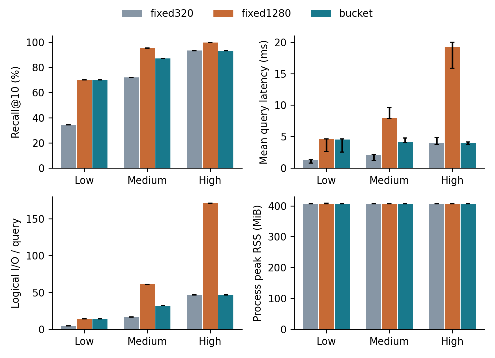

# GateANN 按选择率分桶的搜索预算策略

这是课程实验的外部预算配置实现，核心代码为 `policy.py`，不是 GateANN C++ 内核优化。固定使用课程提供的 GateANN 提交 `71e87cbf0e25c0400c0109dd25a64a7c4dccc9dd`、课程 AIO 兼容性补丁和预构建索引。

## 实现范围

|策略|Low L|Medium L|High L|
|---|---:|---:|---:|
|fixed320|320|320|320|
|fixed1280|1280|1280|1280|
|bucket|1280|640|320|

按课程已有分桶选择 L，再调用原课程适配器；不修改图、过滤逻辑、PQ、Graph Tunneling 或终止条件。规则在测试前固定，不使用本次 Ground Truth 调参。

## 已完成的实测

实验编号 `opt-bucket-01`；YFCC formal_1000000；每桶 200 条查询；每个策略、每桶重复 3 次，共 27 次独立查询进程。固定 threads=1、beamwidth=8、K=10、FullAdj=32、mem-L=0、cache-budget=0。三轮轮换策略顺序。

|分桶|策略|L|Recall %|平均查询延迟 ms|逻辑 I/O|峰值 RSS MiB|
|---|---|---:|---:|---:|---:|---:|
|low|fixed320|320|34.30|1.290|4.38|406.50|
|low|fixed1280|1280|70.05|4.566|13.95|406.62|
|low|bucket|1280|70.05|4.525|13.95|406.50|
|medium|fixed320|320|72.05|2.070|16.75|406.50|
|medium|fixed1280|1280|95.40|8.000|61.15|406.50|
|medium|bucket|640|87.10|4.184|31.93|406.50|
|high|fixed320|320|93.25|3.984|46.72|406.62|
|high|fixed1280|1280|99.65|19.231|171.31|406.50|
|high|bucket|320|93.20|4.016|46.73|406.50|

表中为三次中位数，完整范围见 `results/summary.csv`。原始 27 次命令、查询日志、结果和 54 份负载快照保存在 `results/opt-bucket-01-evidence.tar.gz`，不含数据集或索引。校验说明见 `results/validation.json`。



## 结果解释

- 对比 fixed320：Low Recall 增加 35.75 个百分点，延迟约增至 3.51 倍；Medium 增加 15.05 个百分点，延迟约增至 2.02 倍。
- 对比 fixed1280：Medium 延迟降低 47.70%，但 Recall 下降 8.30 个百分点；High 延迟降低 79.12%，但 Recall 下降 6.45 个百分点。这些不是等质量加速。
- 同一桶中 L 相同的两组执行相同搜索配置，其小差别只能视为运行波动。没有观察到明显峰值 RSS 下降。
- 实验支持预算影响质量与工作量的折中，尚未证明分桶策略在相同 Recall 下优于固定预算。Low Recall 提高后仍只有 70.05%。
- 不主动清理系统或宿主缓存；有虚拟机调用前后快照，宿主机后台负载未记录。时延存在明显波动，三次范围不是置信区间。

## 文件

`policy.py` 为策略和顺序；`run.py` 调用课程适配器并保留证据；`analyze.py` 核对证据并汇总；`test_opt.py` 为无数据依赖的策略测试；`integration.json` 固定上传适配器的接口版本。

## 复现

先在 Ubuntu 22.04 配置课程仓库，准备指定版本 AIO 构建、YFCC 数据和正式索引。将本仓库代码放到课程仓库下的 `gateann_bucket_opt/` 目录，勿覆盖课程适配器。运行：

```bash
cd ~/fvs-course-lab
bash scripts/check_dataset.sh
bash scripts/check_indexes.sh
python3 -m unittest discover -s gateann_bucket_opt -p 'test_*.py' -v
python3 gateann_bucket_opt/run.py --experiment-id opt-bucket-02 --dry-run
python3 gateann_bucket_opt/run.py --experiment-id opt-bucket-02
python3 gateann_bucket_opt/analyze.py course_runs/optimization/opt-bucket-02 --plots
```

使用新编号避免与原测量冲突；中断后对相同编号加 `--resume`。若目录名称不同，也可显式传入 `--course-root`、`--repo`、`--dataset-root`、`--run-root`。运行、校验和统计仅需 Python 标准库；可选绘图需要 matplotlib。

课程仓库：https://gitee.com/wei-fangyu/fvs-course-lab ，备用：https://github.com/wfy2003/fvs-course-lab 。数据、预构建索引、第三方系统源码不包含在本仓库。
